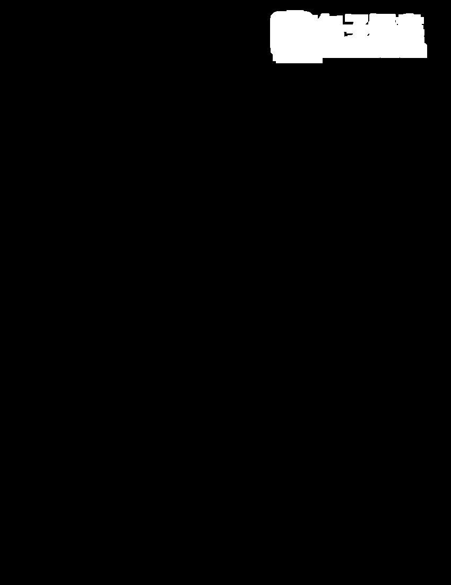
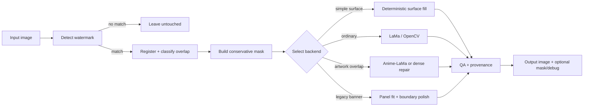

# wmcleaner

**A conservative watermark cleaner for images you are authorized to modify.**

wmcleaner detects a known watermark, builds a tight removal mask that avoids
damaging the surrounding line art, and reconstructs the covered region with
[LaMa](https://github.com/advimman/lama) AI inpainting or a fast OpenCV
fallback. It was built for cleaning watermarks from comic / manhua pages that
the user has the right to edit, such as their own scans, licensed material, or
content they are otherwise permitted to modify.

> **Scope and intent.** This tool is for removing watermarks from images you are
> authorized to modify. It is *not* intended to strip attribution from, or
> otherwise misappropriate, copyrighted works. You are responsible for
> respecting copyright and each site's terms of service. wmcleaner ships with
> **no** comic pages and no scraped chapter content.

---

## Visual overview

The images below are **synthetic**: the artwork is drawn by
`docs/generate_examples.py`, and the watermark is the project's own small
reference template composited onto that artwork. No third-party comic pages are
used anywhere in this repository.

| Before (detected watermark) | Mask | After (OpenCV surface repair) |
| --- | --- | --- |
|  |  |  |

## Features

- **Watermark detection** — template / anchor based detection of the supported
  watermark styles, scaled to the page width.
- **Conservative mask generation** — masks follow the detected watermark
  foreground and preserve dark comic structure (panel borders, text, line art)
  so inpainting does not eat nearby artwork.
- **Multiple reconstruction backends** — LaMa, an anime/manga-finetuned
  *anime-LaMa* variant, an OpenCV fallback, and an `auto` mode that picks what
  is installed.
- **Overlap handling** — a structural-overlap score detects when real artwork
  crosses the watermark and routes those pages to a more careful repair, with
  separate dense-overlap "hybrid" and "precise" strategies.
- **Legacy banner recovery** — dedicated handling for the older translucent
  banner style, including panel fit, boundary polish, and explicit fallback
  modes.
- **Detect-before-clean workflow** — the `detect` command writes masks and debug
  previews without modifying a single source pixel.
- **Batch operation** — point `clean`/`detect` at a directory and it processes
  images recursively.
- **Source adapter architecture** — a registry plus a `SourceScraper` interface,
  with a rate-limited downloader, so supported sources can be added without
  touching the CLI.
- **Doctor / setup tooling** — cross-platform setup scripts and a `doctor`
  command that reports Python, OpenCV, CUDA, and model status.

## How it works



Each page is planned independently: a page with a watermark over plain margin
takes a cheap deterministic path, while a page where the watermark crosses real
artwork is routed to a more careful reconstruction.

## Installation

Python **3.10–3.11** is required.

### Windows

```bat
setup_gpu.cmd       :: NVIDIA GPU + AI (LaMa / anime-LaMa)
setup_cpu_ai.cmd    :: CPU + AI
setup_core.cmd      :: detector + OpenCV only (no AI model)
```

Then verify:

```bat
wmclean.cmd doctor
```

### Linux

```bash
./setup_linux.sh core     # detector + OpenCV only
./setup_linux.sh cpu-ai   # CPU + AI
./setup_linux.sh gpu      # NVIDIA GPU + AI
```

Then:

```bash
./wmclean.sh doctor
```

The first AI run downloads its model once and caches it locally; wmcleaner
bundles no model weights.

## Usage

Inspect first — this never modifies your files:

```bash
wmclean detect ./pages -o ./masks --debug
```

Clean a folder recursively:

```bash
wmclean clean ./pages -o ./cleaned --backend lama --device cuda --save-masks
```

Clean a single image (with no `-o`, the result is written beside it as
`page.cleaned.png`):

```bash
wmclean clean page.png --backend auto --save-masks --debug
```

Copy pages that have no detected watermark too:

```bash
wmclean clean ./pages -o ./cleaned --copy-unmatched
```

Check your installation:

```bash
wmclean doctor
```

### CLI reference

```text
wmclean detect INPUT [-o OUTPUT] [--debug] [--aggressive]
wmclean clean  INPUT [-o OUTPUT] [--backend auto|lama|anime-lama|opencv]
               [--device auto|cuda|cpu]
               [--save-masks] [--debug] [--aggressive]
               [--dilation N] [--min-confidence 0..1]
               [--logo-mask-style solid|precise] [--logo-mask-padding N]
               [--comic-overlap-backend auto|off|anime-lama]
               [--comic-overlap-threshold F] [--comic-dense-overlap-threshold F]
               [--legacy-banner-mode auto|deblend|precise|solid]
               [--copy-unmatched] [--jpeg-quality N]
wmclean scrape       SOURCE OUTPUT [--chapters SELECTOR] [--list-chapters]
                     [--delay SECONDS] [--overwrite] [--no-manifest]
wmclean scrape-clean SOURCE OUTPUT [--chapters SELECTOR]
                     [--in-place | --clean-output DIR] [--replaced-dir NAME]
                     [--backend ...] [--device ...] [--save-masks]
wmclean doctor
```

## Backends

| Backend | What it is | When to use |
| --- | --- | --- |
| `lama` | LaMa inpainting model | Recommended default for restoration/object removal. |
| `anime-lama` | Anime/manga-finetuned LaMa weights | Pages where the watermark crosses line art or text. Selected automatically for overlap. |
| `opencv` | Classical OpenCV inpainting | No model required; good for plain margins and tiny marks, weaker over detailed artwork. |
| `auto` | LaMa when installed, else OpenCV | Sensible default when you are unsure. |

On top of the backend choice, wmcleaner can use a **deterministic surface fill**
when the watermark sits on a plain or smoothly graded surface. That path avoids
the model entirely and is the most conservative option.

## Detection model / templates

The detector is intentionally narrow. It does **not** simply erase "light
things in a corner". Instead it looks for the distinctive anchor graphics of
the supported watermark styles near the expected page edges, confirms the
match, then aligns a high-confidence foreground mask. For the legacy top-left
mark the mask is also intersected with the visible watermark palette and
protects dark text and line art.

The bundled assets in `wmcleaner/templates/` are minimal, low-resolution
reference assets used only for localization. They are **not** intended to
reproduce or represent any publisher's artwork, and no ownership of any
publisher's branding is claimed. A completely different watermark style should
get its own template/detector rather than lowering the confidence threshold
until random page content starts matching.

## Scraping / source adapters

wmcleaner includes a **source-adapter layer** for fetching pages from a
supported source before cleaning. Adapters are implemented against a documented
`SourceScraper` interface and dispatched through a registry that refuses
unsupported domains rather than attempting a generic scrape:

```text
wmcleaner/scrapers/
  base.py        SourceScraper interface + common types
  registry.py    URL/source dispatch; register future adapters here
  baozimh.py     Baozimh reader parsing
  downloader.py  Ordered image download + manifest writing
```

The downloader is deliberately **sequential** and defaults to a delay between
requests so it does not hammer an image server. Preserve that behaviour if you
extend it. The scraping path exists so you can fetch pages from sources you are
permitted to use; it is not a bulk-acquisition tool and should not be used to
mass-download material you have no right to.

`scrape` and `scrape-clean` follow the same rules: use them only on content you
are authorized to download and modify.

## Testing

The public test suite runs entirely on synthetic, generated, and bundled
project fixtures — it does not redistribute any comic or manhua page images.

```bash
python -m pytest tests -q
```

Current public result: **97 tests + 4 subtests pass**.

One module from the private development repository is deliberately **excluded**
from this publication (`tests/test_legacy_regressions.py`). It depends on a
curated corpus of real page fixtures whose redistribution is not defensible.
Its behavioural contracts are still covered by the retained synthetic tests in
`tests/test_legacy_recovery.py` and `tests/test_cleaning.py`. This README does
not claim the excluded module's coverage.

## Limitations

- The auto-detector is tuned to the supported watermark styles. Other
  publishers or logos need their own template.
- Watermarks crossing dense, high-detail artwork are the hardest case; results
  depend on the backend and can leave visible reconstruction artefacts.
- The AI backends require PyTorch and download model weights on first use.
- Scraping depends on the current markup/API of the supported source and may
  need maintenance when that source changes.

## Contributing

See [CONTRIBUTING.md](CONTRIBUTING.md). In short: keep changes scoped, add
tests with synthetic fixtures, and never add copyrighted page images, scraped
chapter content, ground-truth corpora, or archives to the repository.

## License

Original wmcleaner source code is released under the **MIT License** — see
[LICENSE](LICENSE).

That license covers this project's own code only. It does **not** cover
third-party dependencies, externally downloaded AI model weights, or any
source-site content and branding, all of which remain under their own terms.
wmcleaner distributes no comic pages and claims no ownership of any publisher's
material.
